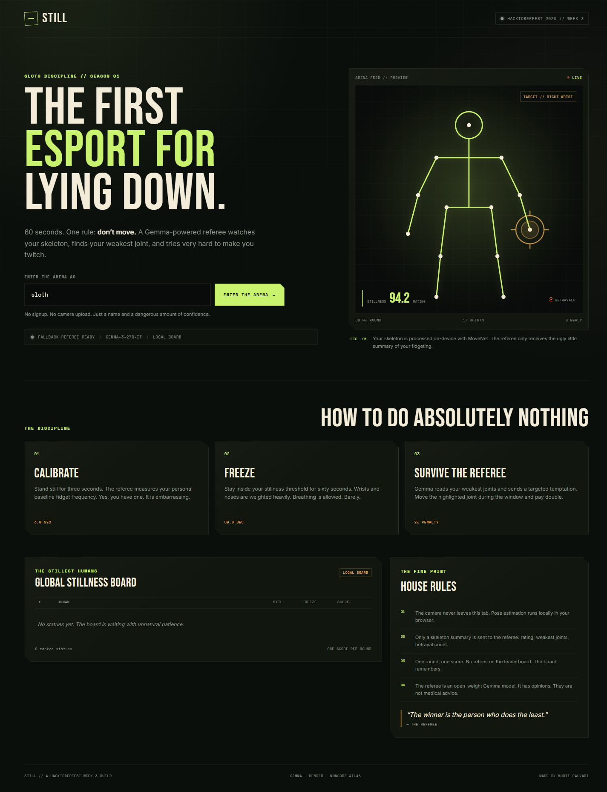
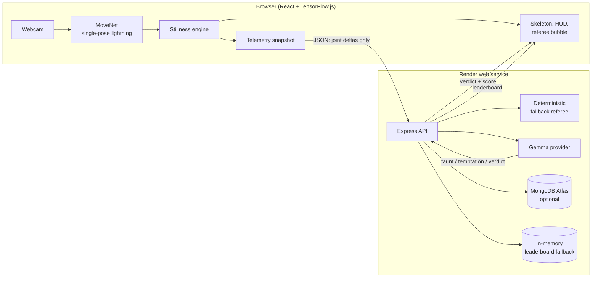
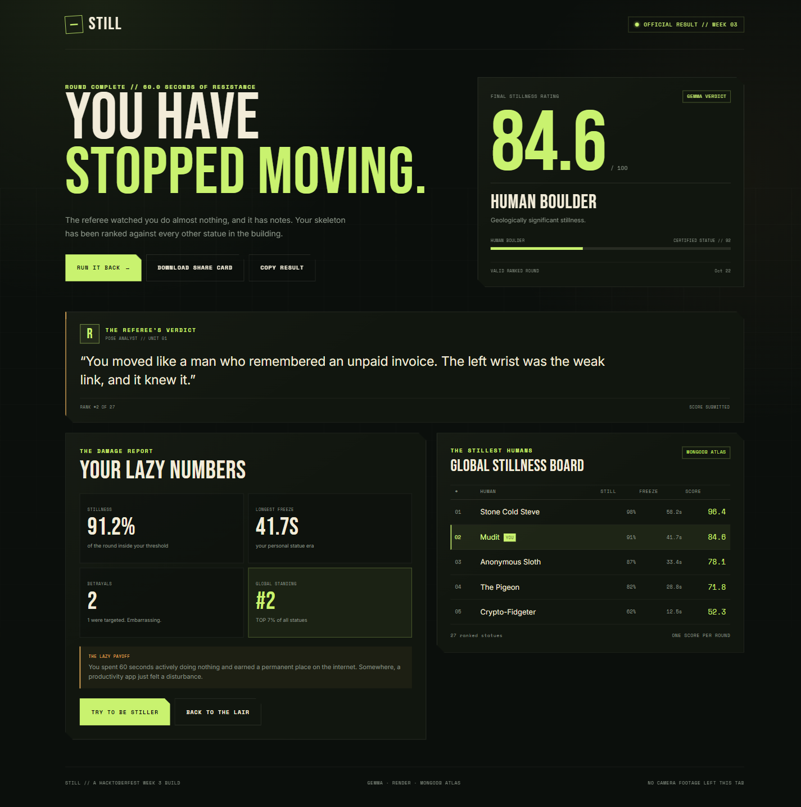
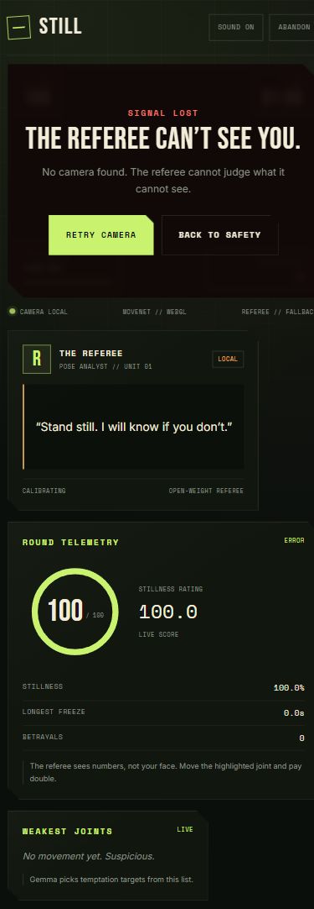

# STILL

**The first esport for lying down.**

Sixty seconds. One rule: **don't move.** A Gemma-powered referee watches your skeleton through the webcam, taunts you when you flinch, and targets your weakest joint with a temptation you are not supposed to survive.

[](docs/landing.png)

> Built for the [Hacktoberfest Open-Source AI Challenge: Week 3 — Slow and Steady](https://dev.to/challenges/hacktoberfest-week3-2026-10-19).

**Live demo:** [https://still-s88j.onrender.com](https://still-s88j.onrender.com)

---

## What it is

STILL turns stillness into a ranked sport.

1. **Calibrate** for three seconds while the referee measures your natural fidget.
2. **Freeze** for sixty seconds while on-device pose estimation scores every twitch.
3. **Survive the referee.** Gemma reads your telemetry, insults your technique, and picks the joint you are least able to control. Move it during the five-second temptation and you lose double points.

Your score combines total stillness, your longest uninterrupted freeze, and the number of betrayals. The stillest human goes on the board.

| Rank | Score | Official assessment |
| --- | ---: | --- |
| Certified Statue | 92+ | The pigeons have accepted you as one of their own. |
| Human Boulder | 80–91 | Geologically significant stillness. |
| Sloth Intern | 65–79 | Promising. Still thinking about lunch. |
| Restless Meat Sack | 45–64 | Your joints are filing a formal complaint. |
| Crypto-Fidgeter | 0–44 | You moved so much the referee got dizzy. |

### The lazy payoff

For once, doing nothing is the winning strategy. No reps, no streak, no productivity system. Sit down, breathe, and let an AI judge your commitment to leisure.

---

## How Gemma is used

Gemma is not a chatbot bolted onto the side. It is the **game director**.

At fixed cue points the client sends a compact telemetry packet — elapsed time, rating, betrayals, stillness percentage, longest freeze, per-joint movement totals, and the last betrayal — to the server. The server prompts an open-weight **Gemma 4 26B A4B** model through Google AI Studio and asks for strict JSON:

```json
{ "line": "A fly has landed on your left wrist. It is reading your messages.", "targetJoint": "left_wrist" }
```

That response becomes one of three things:

- a **taunt** shown in the referee bubble,
- a **temptation** aimed at the player's weakest joint, or
- a **verdict** printed on the results card.

The server validates the joint name, sanitizes the line, and caches responses by round and cue. If Gemma is slow, rate-limited, or unavailable, a deterministic fallback bank keeps the round moving. **The game never blocks on the model.**

The same server also supports fully local inference through [Ollama](https://ollama.com) by setting `GEMMA_PROVIDER=ollama`. No cloud account, no API key, no video leaving the machine.

---

## Why open innovation matters here

A game about not moving needs a referee that can be **specific**. Generic cloud AI would make the same joke about posture every round. An open-weight model gives us something better:

- **It can run locally.** With Ollama, STILL works offline after the initial pose model download. No camera feed, telemetry, or verdict has to leave the laptop.
- **It can be inspected and tuned.** The prompt, the JSON schema, the fallback behavior, and the scoring constants are all in this repository. Anyone can change what the referee values or how cruel it is allowed to be.
- **It is not a rented personality.** Swapping Google AI Studio for a local Gemma build is one environment variable. The game does not depend on a single vendor staying online, staying affordable, or keeping the same model behind the same name.
- **It keeps the client honest.** Pose estimation runs entirely in the browser with TensorFlow.js MoveNet. The server receives joint deltas, not frames. Open tooling made that privacy-preserving split practical.

The interesting part is not the model alone. It is the loop: **open pose model → transparent scoring rules → open-weight language model → inspectable code.**

---

## Architecture



### Stack

| Layer | Choice |
| --- | --- |
| Front end | React 19, TypeScript, Vite |
| Pose estimation | TensorFlow.js + MoveNet (on-device, WebGL with CPU fallback) |
| Scoring | Deterministic TypeScript engine with unit tests |
| Referee | Gemma 4 26B A4B via Google AI Studio, or local Gemma via Ollama |
| API | Node.js, Express 5, TypeScript |
| Leaderboard | MongoDB Atlas when configured, otherwise in-memory |
| Hosting | Render |
| License | MIT |

---

## Run it locally

### Requirements

- Node.js 22+
- A webcam
- Optional: a [Google AI Studio](https://aistudio.google.com/apikey) API key, or [Ollama](https://ollama.com) with a Gemma model

```bash
npm install
cp .env.example .env   # Windows: copy .env.example .env
npm run dev
```

Open <http://localhost:5173>. The API runs on <http://localhost:3001> and Vite proxies `/api` to it.

Without `GEMMA_API_KEY` or `MONGODB_URI`, the app still works: the referee uses its offline lines and the leaderboard lives in memory. That is intentional — the game should be playable in one command.

### Environment variables

| Variable | Default | Purpose |
| --- | --- | --- |
| `PORT` | `3001` | API port |
| `MONGODB_URI` | _(empty)_ | MongoDB Atlas connection string; falls back to memory |
| `MONGODB_DB` | `still` | Database name |
| `GEMMA_PROVIDER` | `google` | `google` (AI Studio) or `ollama` (local) |
| `GEMMA_API_KEY` | _(empty)_ | Google AI Studio key |
| `GEMMA_MODEL` | `gemma-4-26b-a4b-it` | Model id; for Ollama, e.g. `gemma3:4b` |
| `OLLAMA_URL` | `http://127.0.0.1:11434` | Local Ollama endpoint |

Google AI Studio:

```bash
GEMMA_PROVIDER=google
GEMMA_API_KEY=your-key
GEMMA_MODEL=gemma-4-26b-a4b-it
```

Fully local:

```bash
ollama pull gemma3:4b
GEMMA_PROVIDER=ollama
GEMMA_MODEL=gemma3:4b
```

### Scripts

```bash
npm run dev        # API + Vite client with hot reload
npm test           # scoring engine tests (Vitest)
npm run build      # build client and server
npm start          # serve the production build
```

---

## Scoring, in plain English

Every pose is normalized against torso length, so moving closer to the camera does not count as moving. A robust baseline is measured during calibration (`median + 2.5 × MAD`) and subtracted from all future motion.

- **Stillness** — the percentage of frames below the calibrated stillness threshold.
- **Longest freeze** — the longest uninterrupted still streak, as a percentage of the round.
- **Betrayal** — sustained movement above `max(0.008, baseline × 3.5)`. Costs 1 point.
- **Targeted betrayal** — moving the joint Gemma specifically warned you about. Costs 2 points.

```text
rating = clamp(0.7 × stillness% + 0.3 × longestFreeze% − 2 × betrayals, 0, 100)
```

The point is not perfect physical accuracy. The point is a legible, fair-feeling game that rewards the same thing every round: **not moving**.

Camera frames never leave the browser. The API receives only normalized joint movement summaries.

---

## Project structure

```text
client/
  src/
    components/      Start, game arena, referee, leaderboard, summary
    hooks/           Camera lifecycle and MoveNet inference loop
    lib/             Scoring engine, API client, canvas overlay, audio, share card
server/
  index.ts           Express routes, rate limits, static hosting
  lib/db.ts          MongoDB Atlas + in-memory leaderboard
  lib/gemma.ts       Google AI Studio / Ollama referee adapter
  lib/fallback.ts    Deterministic referee lines
  lib/validate.ts    Input sanitization and telemetry limits
shared/              Types and constants used by both sides
tests/               Scoring engine unit tests
render.yaml          One-click Render blueprint
```

### API

| Method | Route | Purpose |
| --- | --- | --- |
| `GET` | `/api/health` | Gemma configuration and database status |
| `POST` | `/api/rounds` | Issue a single-use round id |
| `POST` | `/api/referee` | Generate a taunt, temptation, or verdict |
| `POST` | `/api/scores` | Consume the round and submit a score |
| `GET` | `/api/leaderboard` | Top scores, rank metadata, storage source |

Scores are tied to a single-use round id to prevent casual replay spam. Rate limits are applied per IP.

---

## Deploy to Render

The repository includes a [`render.yaml`](render.yaml) blueprint:

1. Push the repository to GitHub.
2. In Render, choose **New → Blueprint** and select the repository.
3. Set `GEMMA_API_KEY` (and `MONGODB_URI` if you want a persistent board).
4. Deploy. The health check is `/api/health`.

Without `MONGODB_URI`, the free instance uses an in-memory leaderboard that resets on restart. Add a MongoDB Atlas cluster and set the connection string to make the board permanent.

---

## Screenshots

| Landing | Result |
| --- | --- |
|  |  |

Camera-denied handling is a first-class state, not a crash:



---

## Built with

Gemma · Google AI Studio · TensorFlow.js MoveNet · React · TypeScript · Express · MongoDB Atlas · Render

MIT licensed. See [LICENSE](LICENSE).
